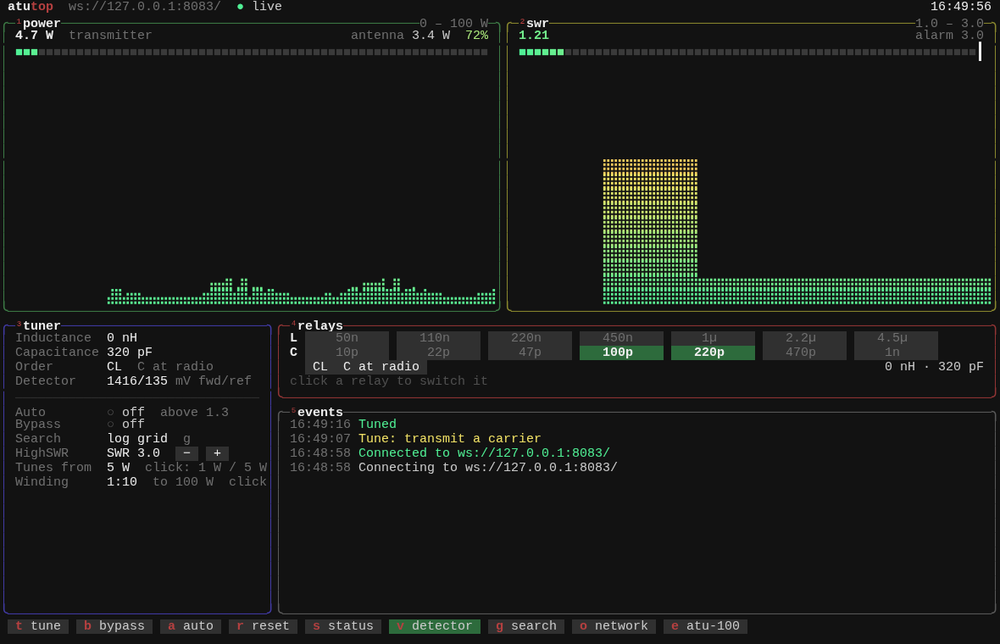

# ATU-100 EXT firmware: display, buttons and serial remote control

Firmware for the N7DDC ATU-100 **EXT** automatic antenna tuner (PIC16F1938,
7 inductors, 7 capacitors) that keeps everything the original does, with
the **display and all three buttons**, and adds a **serial link** so an
Arduino, an ESP32 or a computer can read the SWR and power and control the
tuner.

- The display and buttons work exactly as in N7DDC's firmware.
- 4800 baud serial on PIC pins 9 and 10, with JSON messages: status, SWR,
  transmitter and antenna power, relays, events, settings.
- A tuning search that finds a match far more often than the original
  (the original is still there, one setting away).
- High SWR alarm, detector readings, settings that apply without a restart.
- **atutop**, a btop-style terminal program with gauges, graphs and mouse
  control; Python tools for scripting; an Arduino Mega sketch to start from.
- A PC simulator that runs the real firmware code, so it can be tested
  without a tuner.

> **Status, October 2026:** everything here has been tested in the
> simulator only. It has not yet been flashed into a tuner or used on the
> air. Keep the backup described under [Installing](#installing) so you can
> go back to your old firmware.

This is the `display-buttons-uart` branch of
[randal007/ATU-100-remote](https://github.com/randal007/ATU-100-remote).
See [History](#history) for the line of projects it comes from.

## Contents

- [What is different](#what-is-different)
- [Hardware](#hardware)
- [Installing](#installing)
- [Front panel](#front-panel)
- [Serial protocol](#serial-protocol)
- [Settings (EEPROM cells)](#settings-eeprom-cells)
- [Tuning searches](#tuning-searches)
- [atutop](#atutop)
- [Python tools](#python-tools)
- [Arduino Mega sketch](#arduino-mega-sketch)
- [Building](#building)
- [Testing without a tuner](#testing-without-a-tuner)
- [Source files](#source-files)
- [Limitations and ideas](#limitations-and-ideas)
- [History](#history)

## What is different

| | N7DDC 3.2 | ukoda's remote firmware | This firmware |
|---|---|---|---|
| Display | yes | no | yes |
| Buttons | 3 | none | 3 |
| Serial port | none | pins 22/23 (the Auto and Bypass buttons) | pins 9/10 (the Tx_req pins) |
| Tx_req output to the radio | yes | no | no: `Tune`/`Tuned` messages instead |
| Tuning | N7DDC search | N7DDC search | log grid search, or N7DDC's |
| Antenna power and efficiency over serial | — | reported as "Power" | separate fields |
| High SWR alarm, detector readings, live settings | — | — | yes |

Bugs fixed along the way, in N7DDC's code, the XC8 port and the serial code:
features the XC8 port had dropped (RF waking the display, the 9999 W
limit), the ADC sampling before its input had settled, test mode limiting
the capacitors by the inductor count, a division by zero in the antenna
power maths, antenna power and efficiency going stale when only the SWR
changed, serial bits corrupted when sending and receiving at once, a
message lost after a number followed by `}`, wrong L/C in bypass, and in
the Python tools a bypass command that did the opposite and relay commands
that ignored which side the capacitors were on. The commit messages have
the details.

## Hardware

### Which boards

The ATU-100 **EXT** board with a **PIC16F1938**. The mini board and the
PIC18F2520 version are not supported.

### Serial wiring

| PIC pin | Schematic name | Direction | To an Arduino Mega | To a 3.3 V board (ESP32) |
|---|---|---|---|---|
| 9, RA7 | `RA7 - Tx_req` | out of the tuner | RX1, pin 19 | RX, through a 2.2 kΩ / 3.3 kΩ divider |
| 10, RA6 | `RA6 - /Tx_req` | into the tuner | TX1, pin 18 | TX, direct |
| 8 or 19 | GND | | GND | GND |

**Pins 9 and 10 are not connected to anything on N7DDC's PCB** (checked
against his gerber files; the schematic labels are only net names). Solder
fine wire, wire-wrap or enamelled, straight to the two pins and glue the
wires down. Clone boards may be laid out differently.


- **Fit a 10 kΩ pull-up from pin 10 (RA6) to the partner's supply** (5 V for
  a Mega, 3.3 V for an ESP32). Port A has no internal pull-ups; without one
  a disconnected or unpowered partner leaves the input floating inside an
  RF box, and noise can look like commands.
- Inside an amplifier: 1 kΩ in series with each line at the PIC end,
  100 pF to ground on the PIC side of it, twisted pair with ground, and a
  ferrite on the cable.
- Do not power anything extra from the tuner's 5 V: it is a 78L05 (100 mA).
  An ESP32 needs its own supply, for example a 7805 from the tuner's 12 V
  input with its tab bolted to the chassis.

### Display and buttons

Unchanged from N7DDC: the display on the 5-pin PROG header (I2C on RB6/RB7),
Tune on RB0, Auto on RB1, Bypass on RB2.

## Installing

You need a PIC programmer. A **PICkit 3** works with **MPLAB X / MPLAB IPE
v6.20 or older** (Microchip's archive page; v6.25 dropped the PICkit 3).
A PICkit 4 or 5 works with current versions.

The programmer goes on the 5-pin PROG header, which is also the display
connector, so unplug the display first:

| PROG pin | 1 | 2 | 3 | 4 | 5 |
|---|---|---|---|---|---|
| Signal | MCLR | +5 V | GND | DAT (PGD) | CLK (PGC) |

The pin order matches pins 1 to 5 of a PICkit.

1. **Back up the tuner.** Read the whole chip with MPLAB IPE and save it as a
   hex file. Keep it: programming it back restores your old firmware and
   settings. Convert its settings for later:
   `python/atu100hextojson.py backup.hex settings.json`.
2. **Program the new firmware**,
   `ATU-100_display_uart_PIC16F1938_<date>.hex` from this folder, with
   **Preserve EEPROM Memory** ticked in MPLAB IPE's settings. If you forget,
   restore the settings over serial afterwards:
   `python/atu100.py -p PORT -c u -e settings.json`.
   The settings matter: N7DDC's defaults are for a 1602 LCD, the defaults in
   this hex are for a 128×64 OLED, and the wrong display type leaves the
   screen blank.
3. **Check it.** At power up the display shows the ATU-100 splash as before,
   and the serial port sends `{"Event":"Startup"}` and the board information.

The stock firmware has low-voltage programming turned off, so the first
flash needs a programmer that supplies about 9 V on MCLR (every PICkit
does). This firmware turns it on, so later updates also work from 5 V-only
programmers.

## Front panel

As in N7DDC's firmware:

- **Tune**: a short press resets the relays (no matching), a long press
  tunes. Transmit a carrier of at least the minimum power (cell 05) while it
  tunes.
- **Bypass**: relays out and back in. `_` after the power shows bypass.
- **Auto**: automatic tuning when the SWR rises above cell 04. `.` after
  the power shows auto mode.
- Held at power up: Auto + Bypass for step-by-step test mode, all three for
  the all-relays-on fast test, Tune for setting the feeder loss.

Serial commands act like button presses, including waking the display after
the display-off timer (cell 32).

## Serial protocol

**4800 baud, 8N1**, 5 V TTL. Lines end with `\n`.

- The tuner sends one JSON object per line.
- Messages to the tuner are JSON objects, one or more fields, any
  whitespace, **one message per line**: `{"Tune": true}`. The tuner answers
  within a few ms (it breaks off a measurement when a message starts
  arriving) and buffers 128 characters. If characters are lost, it drops the
  damaged message instead of acting on part of it. Waiting for each answer
  before sending the next command is still the safe way.
- Straight after power up the first measurement takes about half a second;
  a status asked for before then shows no power.
- Single characters outside `{}` work like the buttons, for typing in a
  terminal: `t` tune, `r` reset, `b` bypass on/off, `a` auto on/off,
  `s` status.

### From the tuner

**Status**, whenever something changes, and in answer to `{"Status": true}`:

```
{"Auto":false,"Bypass":false,"Power":10.0,"Antenna":7.2,"Efficiency":72,"SWR":1.21,"Order":"CL","Capacitance":320,"Inductance":0}
```

| Field | Meaning |
|---|---|
| `Auto`, `Bypass` | modes, true/false |
| `Power` | transmitter power in W, as after PWR= on the display: 0.1 W steps, or 1 W steps in high power mode (cell 30) |
| `Antenna` | power reaching the antenna after feeder loss (cell 34) and mismatch, W. Only while the display shows ANT/EFF: cell 33 on and power present |
| `Efficiency` | percent, with `Antenna` |
| `SWR` | two decimals; 0.00 under 1 W (N7DDC's firmware does not measure the SWR below 1 W). Measured again straight after relays change, so a status after `RelayI`, `RelayC` or bypass carries the new SWR |
| `Order` | `LC`: capacitors on the antenna side; `CL`: on the transmitter side |
| `Capacitance`, `Inductance` | of the relays that are on, pF and nH |

**Events**: `{"Event":"Tune"}`

| Event | When |
|---|---|
| `Startup` | power up, followed by `{"Board":"ATU-100_EXT","Credit":"N7DDC","FW":"3.2","Build":"VE7NHW display+serial 1.0, Oct 23 2026"}`: the firmware's revision and build date, shown at the top of atutop |
| `Restart` | the watchdog restarted the tuner |
| `Tune` | a tune starts: transmit a carrier now. This replaces N7DDC's Tx_req signal. Any waiting status goes out first, so after an auto tune starts the high SWR that started it has already been reported |
| `Tuned` | the tune has finished: stop the carrier. A status line follows |
| `Reset` | the relays were reset (button, command, or a tune given up) |
| `HighSWR` | SWR at or above the limit in cell 37 with power present, with the reading: `{"Event":"HighSWR","SWR":2.76}`; sent within a few ms, again only after the SWR has dropped 0.1 below the limit or the power has gone. Not checked while tuning |
| `HighPower` | more power than the tuner is set up for: above 100 W (the board's rating) with the stock 1:10 tandem match, 1.4 W × ratio² with a smaller one (35 W at 1:5); off in high power mode (cell 30). With the reading: `{"Event":"HighPower","Power":120.4}`. Sent again only after the power has dropped 10% |
| `Overload` | more power than the detector can measure |
| `Error` | a command the tuner did not understand |
| `Busy` | a command that arrived while a tune was waiting for carrier, and was not done |

**Detector voltages**, answer to `{"Raw": true}`, in mV before the diode
correction: `{"Fwd":2697,"Rev":261}`

**EEPROM**: one cell `{"37":"30"}` or all 256 in one line, hex addresses
and values.

### To the tuner

| Message | Does |
|---|---|
| `{"Status": true}` | send the status |
| `{"Tune": true}` | tune, as a long press of Tune |
| `{"Reset": true}` | reset the relays, as a short press of Tune |
| `{"Bypass": true}` / `false` | bypass on or off |
| `{"Auto": true}` / `false` | auto mode on or off (`Error` while in bypass) |
| `{"Raw": true}` | detector voltages |
| `{"RelayI": n}` | inductor relays as a bit set, 0 to 127; bit 0 is the smallest |
| `{"RelayC": n}` | capacitor relays, 0 to 127, plus 128 for the capacitors on the antenna side (LC) |
| `{"Get": cell}` | read an EEPROM cell, address in decimal |
| `{"Set": cell, "Value": n}` | write a cell, both in decimal. Takes effect at once; display settings restart the display |
| `{"Dump": "EEPROM"}` | all 256 cells (about 6 seconds at 4800 baud) |
| `{"x": true}` | restart the tuner |

A tune waits for carrier for up to about a minute. While it waits, the
tuner still answers `Status` and `Raw` (and `s`). `{"Reset": true}` or
`{"Tune": true}` (or `r`, `t`) stops the tune and resets the relays, as
the Tune button does. Any other message is not done and gets a `Busy`
event. Messages that arrive during the search itself, once the carrier is
on, are handled when the tune has finished.

## Settings (EEPROM cells)

Hex addresses. Values are entered as they read: 15 means 15, 13 means 1.3
for an SWR (N7DDC calls this "hexadecimal" but it is BCD). Defaults are
N7DDC's, except where noted. Change them with the front panel where
N7DDC provides it, with `{"Set": ...}`, with `atu100.py -c s`, or in
`atu100diagnostics.py`.

| Cell | Setting | Default |
|---|---|---|
| 00 | Display I2C address: 4E/7E for a 1602 LCD backpack, 78/7A for an OLED | 4E (78 in this hex) |
| 01 | Display: 00 two-colour LED, 01 1602 LCD, 02/03 128×32 OLED normal/inverted, 04/05 128×64 OLED normal/inverted | 01 (05 in this hex) |
| 02 | Auto mode, 00 off, 01 on (the Auto button writes it) | 00 |
| 03 | Relay settling time, ms | 15 |
| 04 | Auto mode tunes above this SWR | 13 (1.3) |
| 05 | Minimum power to tune, W (tens of W in high power mode) | 05 |
| 06 | Maximum power to tune, 00 = no limit | 00 |
| 07, 08 | OLED position, rows down and columns left | 01, 02 (00, 02 in this hex) |
| 09 | Do not tune if the SWR starts above this, 00 = always tune | 00 |
| 0A, 0C | Number of inductors, capacitors (05 to 07) | 07, 07 |
| 0B, 0D | 01 if the inductors, capacitors have linear steps | 00, 00 |
| 0E | Software correction of the detector diodes | 01 |
| 0F | 01 for inductor relays with normally open contacts | 00 |
| 10–1D | Inductor values, two cells each, smallest first, nH: 01 10 = 110 nH | 50, 110, 220, 450, 1000, 2200, 4500 |
| 20–2D | Capacitor values, two cells each, pF | 10, 22, 47, 100, 220, 470, 1000 |
| 30 | High power mode, 01 = up to 9999 W in 1 W steps | 00 |
| 31 | Tandem match turns ratio: must match the transformer's winding. 10 = 1:10 (stock: measures to 150 W, board rated 100 W); 05 = 1:5 (to about 40 W, better at 1 to 5 W). Sets the HighPower limit | 10 |
| 32 | Display-off timer, seconds, 00 = always on | 00 |
| 33 | Show antenna power and efficiency, 01 = on | 01 |
| 34 | Feeder loss, dB: 12 = 1.2 dB | 12 |
| 35 | 01 = release the relays while the display is off | 00 |
| **36** | **Tuning search**: 00 = N7DDC's original, anything else = log grid search | FF (log grid) |
| **37** | **HighSWR limit**: 25 = 2.5, 00 = off, FF = 3.0 | FF (3.0) |
| FB, FC | Last SWR (low, high byte) | |
| FD | Last capacitor side, 01 = LC | |
| FE, FF | Last inductor and capacitor relays | |

Cells 36 and 37 are new in this firmware; on a tuner coming from another
firmware they read FF, which gives the defaults.

## Tuning searches

N7DDC's search steps the inductors from zero in coarse jumps (about
600 nH), at each step sweeps the capacitors, and moves on only while the
SWR keeps improving. It then fine-tunes L and C one at a time. It is fast,
but it often stops short, mostly on the upper bands, where the right values
are small and fall between its coarse steps.

The log grid search tries L and C on a logarithmic grid (relay values
0, 1, 2, 3, 4, 6, 8, 11, 16, 22, 32, 45, 64, 90, 127, for both capacitor
sides), skipping the rest of a row once the SWR has passed its dip, and
then fine-tunes L and C together. New best readings are measured twice, so
detector noise does not mislead it.

In the simulator, over about 1100 antenna loads from 160 to 10 m that the
relays can match below SWR 1.5, with 1% detector noise:

| | N7DDC original | Log grid search |
|---|---|---|
| Tuned below SWR 1.5 | 46% | 91% |
| Of loads starting below SWR 10 | 65% | 98% |
| Left at SWR 2 or worse | 44% | 5.5% |
| Typical tune time | about 1 s | about 3 s |

The simulator's antenna and detector are idealised, so these numbers need
confirming on the air. Compare the two on your own antennas by switching
cell 36: `atu100.py --search original` and `--search grid`.

## atutop

A terminal program in the style of btop, written in Rust: one file, no
Python needed.



- **power**: transmitter power, antenna power and efficiency, a gradient
  meter and a five-minute history graph. The scale follows the peak.
- **swr**: SWR with a meter from 1.0 to 3.0, the HighSWR limit marked on it,
  and its history. The box flashes red on a HighSWR alarm.
- **tuner**: inductance, capacitance, capacitor side, detector voltages,
  auto, bypass, the tuning search and the HighSWR limit.
- **relays**: every inductor and capacitor; lit ones are switched in.
  **Click one to switch it**, click the LC/CL chip to move the capacitors.
- **events**: tunes, resets, alarms, with times.
- While tuning, the power box shows **TUNING · transmit a carrier**.

Mouse: click the buttons at the bottom, the relays, Auto, Bypass, Search or
Detector; the scroll wheel on HighSWR changes the limit. Keys: `t` tune,
`b` bypass, `a` auto, `r` reset, `s` status, `v` detector voltages once a
second, `g` tuning search, `[` `]` HighSWR limit, `q` quit.

```
atutop                          # the connect screen ($ATU100_PORT skips it)
atutop /dev/ttyUSB0
atutop socket://atu100.local:7000
```

**Connect screen** (at start without a port, or `c`): USB serial ports
named from their USB IDs (ESP32, Arduino, CH340...), ESP32 bridges found
on the network (UDP broadcast to port 7001, and `atu100.local`), the ports
used before (`~/.config/atutop/recent`), an address to type, and
**simulator**: starts the simulated tuner and ESP32 bridge from
`test/` so everything can be tried without hardware.

**Settings** (`o`): the link, and with an ESP32 bridge its Wi-Fi: scan,
pick a network, password, IP address from the router or fixed
(address, gateway, mask), connect, forget, and **use Wi-Fi** to move
from USB to Wi-Fi without restarting. Wi-Fi settings change over USB only.
atutop reconnects by itself when the link drops.

**Power and the detector winding:** the power meter's scale follows the
tandem match winding (cell 31): 0–100 W for the stock 1:10, 0–40 W for 1:5,
with the HighPower limit marked; the box flashes **HIGH POWER** on the
alarm. Click **Winding** in the tuner box to change it: a box asks how the
transformer is wound, warns that it must match, and that the 1:5 winding
overloads the detector above about 40 W, and offers to set "Tunes from" to
match (5 W or 1 W). Click **Tunes from** to switch the minimum tuning
power (cell 05) between 5 W and 1 W; other values can be set with
`atu100.py -c s -a 05 -d NN`.

**Web server:** with an ESP32 bridge the top line shows "● web server
online" and the address this computer reaches it at (home network or the
bridge's hotspot; checked every 10 seconds), or in yellow "not reachable
from here" when this computer is on neither. Click it to open the page in
the browser.

It works from 80×24 up and takes the port for itself, so it and the Python
tools cannot talk to the tuner at the same time. Commands go out one at a
time, each after the tuner has answered the last; quick repeats of the same
setting (a spin of the wheel) are merged into one, and quick clicks keep
their place even when a status line crosses them. While a tune runs only
Reset, the status and the detector readings go out. It reads the settings and
relay values from the tuner when it starts (about 6 seconds).

Build it with Rust (stable): `cd tui && cargo build --release`, giving
`tui/target/release/atutop`; copy it somewhere on your PATH. It uses
ratatui, crossterm and serialport, which also run on Windows and macOS,
but it has only been tried on Linux.

## Python tools

In the `python` folder; they need Python 3 and pyserial
(`pip install pyserial`).

The port can be a serial device (`/dev/ttyACM0`, `COM3`) or a pyserial URL,
such as `socket://atu100.local:7000` for a network bridge. Set
`ATU100_PORT` to avoid typing `-p` every time.

| Program | Use |
|---|---|
| `atu100.py` | command line, and the library the others use |
| `atu100remote.py` | full-screen status and control |
| `atu100diagnostics.py` | full-screen setup: all settings, relays one by one |
| `atu100hextojson.py` | settings from a hex backup to JSON, for restoring |

Exit the full-screen programs with `q` or Esc, not Ctrl-C, or the terminal
fills with mouse codes.

### atu100.py

```
./atu100.py -p /dev/ttyACM0            status
./atu100.py -c t                       tune, waits for the result
./atu100.py -c B / -c b                bypass on / off
./atu100.py -c A / -c a                auto on / off
./atu100.py -c r                       reset the relays
./atu100.py -c v                       detector voltages
./atu100.py -c m                       show everything the tuner sends, until Ctrl-C
./atu100.py -c x                       restart the tuner
./atu100.py --swr-alarm 2.5            HighSWR limit (0 = off)
./atu100.py --search original          N7DDC's search (grid for the new one)
./atu100.py -c I -r 2 / -c i -r 2      inductor relay 2 on / off
./atu100.py -c C -r 0 / -c c -r 0      capacitor relay 0 on / off
./atu100.py -c l / -c f                capacitors on the antenna / transmitter side
./atu100.py -c g -a 37                 read cell 37 (hex)
./atu100.py -c s -a 37 -d 25           write cell 37 (hex)
./atu100.py -c d -e settings.json      save all cells
./atu100.py -c u -e settings.json      write back the cells that differ
```

```
$ ./atu100.py -c t
Starting tuning: transmit a carrier until the Tuned event

Event:       Tune

Event:       Tuned

Auto:        Disabled
Bypass:      Disabled
Power:       10.0 W
Antenna:     7.2 W
Efficiency:  72 %
SWR:         1.21
Order:       CL
Capacitance: 320 pF
Inductance:  0 nH
```

### atu100remote.py

```
┌─ ATU-100 Remote ─────────────────────────────┐
│Power:       10.0 W  Order:             CL    │
│SWR:         1.21    Capacitance:      320 pF │
│Antenna:      7.2 W  Inductance:         0 nH │
│Efficiency:    72 %  Detector:    2697/261 mV │
│Auto:    Disabled    Bypass:      Disabled    │
│Event:      Tuned    Tune:            Done    │
└──────────────────────────────────────────────┘
```

Keys: `t` tune, `b` bypass, `a` auto, `r` reset, `s` status, `v` detector
voltages once a second on/off, `q` quit. Double click Auto, Bypass or Tune
to do the same. HighSWR and the SWR show in red.

### atu100diagnostics.py

Status, the whole EEPROM and the settings decoded:

```
┌─ ATU-100 Status ─────────────────────────────┐┌─ EEPROM data ─────────────────────────────────────┐
│Power:       10.0 W  Order:             CL    ││Add -0 -1 -2 -3 -4 -5 -6 -7 -8 -9 -a -b -c -d -e -f│
│SWR:         1.21    Capacitance:      320 pF ││---------------------------------------------------│
│Ant/Eff:    7.2/72%  Inductance:         0 nH ││0-  78 05 00 15 13 05 00 00 02 00 07 00 07 00 01 00│
│Auto:    Disabled    Bypass:      Disabled    ││1-  00 50 01 10 02 20 04 50 10 00 22 00 45 00 ff ff│
│Event:      Tuned    Tune:            Done    ││2-  00 10 00 22 00 47 01 00 02 20 04 70 10 00 ff ff│
└──────────────────────────────────────────────┘│3-  00 10 00 01 12 00 ff 20 ff ff ff ff ff ff ff ff│
┌─ Configuration ──────────────────────────────┐│4-  ff ff ff ff ff ff ff ff ff ff ff ff ff ff ff ff│
│Inds (nH):   50  110  220  450 1000 2200 4500 ││5-  ff ff ff ff ff ff ff ff ff ff ff ff ff ff ff ff│
│Caps (pf):   10   22   47  100  220  470 1000 ││6-  ff ff ff ff ff ff ff ff ff ff ff ff ff ff ff ff│
│03: Timeout 15 mS      04: Auto SWR thres 1.3 ││7-  ff ff ff ff ff ff ff ff ff ff ff ff ff ff ff ff│
│05: Minimum power  5 W 06: No maximum power   ││8-  ff ff ff ff ff ff ff ff ff ff ff ff ff ff ff ff│
│09: No max initial SWR 0e: Linearity correct  ││9-  ff ff ff ff ff ff ff ff ff ff ff ff ff ff ff ff│
│0f: Normal ind relays  30: Measure to 999 W   ││a-  ff ff ff ff ff ff ff ff ff ff ff ff ff ff ff ff│
│31: Tandum match 1:10  33: Efficeny indication││b-  ff ff ff ff ff ff ff ff ff ff ff ff ff ff ff ff│
│34: Feed loss 1:1.2    35: Disable relays 0   ││c-  ff ff ff ff ff ff ff ff ff ff ff ff ff ff ff ff│
│36: Log grid search    37: HighSWR at 2.0     ││d-  ff ff ff ff ff ff ff ff ff ff ff ff ff ff ff ff│
│fb: Last SWR 0:0       fd: Last SW 1          ││e-  ff ff ff ff ff ff ff ff ff ff ff ff ff ff ff ff│
│fe: Last inductor 0    ff: Last capacitor 0   ││f-  ff ff ff ff ff ff ff ff ff ff ff 00 00 01 00 00│
└──────────────────────────────────────────────┘└───────────────────────────────────────────────────┘
```

Keys: `a` auto, `b` bypass, `r` reset, `T` tune, `s` status and EEPROM
again, `X` restart, `c` or `l` then `0`–`6` to toggle a capacitor or
inductor relay, `o` capacitor side, `e` to edit the EEPROM (hex digits,
Enter to send, arrow keys to move), `q` quit. Double click a green EEPROM
value to edit it.

EEPROM colours: green = a setting in use, magenta = valid but ignored,
grey = unused, white on red = not blank and not documented, blue = being
edited.

## Arduino Mega sketch

`arduino/atu100_bridge/atu100_bridge.ino` is a starting point for a Mega
on Serial1:

- passes everything between the tuner and the Mega's USB port, so the
  Python tools work through the Mega;
- keeps the latest SWR, power, relays and detector readings in variables;
- drives pin 22 high from `Tune` to `Tuned`, in place of the Tx_req signal,
  to key a low power carrier and keep an amplifier in bypass;
- sets `atuHighSwr` on the `HighSWR` event;
- has functions for tune, reset, bypass, status, detector readings and
  setting relays.

## ESP32 bridge

`esp32/atu100_bridge/atu100_bridge.ino`, for a **Seeed XIAO ESP32S3 Plus**.
It sits between the tuner and everything else:

- **USB**: everything passes between the USB port and the tuner, so atutop
  and the Python tools work as with a USB serial adapter.
- **Wi-Fi**: the same on TCP port 7000 (`socket://atu100.local:7000`, two
  clients at a time), a web page on port 80 (SWR, power, L and C, Tune,
  Reset, Bypass, Auto), and an answer on UDP port 7001 so atutop's connect
  screen finds it.
- **Mega**: a second serial port, as if the Mega were wired to the tuner;
  the Mega sketch needs no change. Only JSON lines from the Mega reach the
  tuner, so a loose wire cannot send the tuner's one-letter commands.
- Lines are passed whole: messages from different sides never mix.
- Its own messages carry an `"ESP32"` field and never reach the tuner (the
  tuner ignores them, so atutop's probe is harmless without a bridge):
  `Info`, `Scan`, `WiFi`, `Forget`, answered with `Info`, `Net` lines and
  `Scan`, `OK` or `Error`. `test/esp32_sim.py` does the same on a PC.
- **Its own hotspot**, **ATU100-setup**, password **hamradio**, address
  **192.168.73.1**: comes up when no network is saved or the saved one
  cannot be joined for 20 seconds, and everything works on it (the web
  page, port 7000, atutop's search, `atu100.local`), so a laptop or phone
  can use the tuner off-grid with no other network. Pick a network from
  its setup page, `http://192.168.73.1/setup`. Without anyone on the
  hotspot it tries the saved network every 30 seconds; it closes the
  hotspot half a minute after joining, unless it is set to **always on**
  (atutop's settings, over USB).
- The hotspot and the home network share one radio, so the hotspot uses
  the home network's channel: when the bridge joins a network, anything on
  the hotspot drops for a moment and reconnects. That is why it does not
  try the network while someone is on the hotspot.
- **Wi-Fi settings change over USB only** (atutop's settings), or from the
  hotspot's setup page. IP address from the router, or fixed.

| XIAO pin | To | Note |
|---|---|---|
| D7 (GPIO44), RX | tuner RA7, PIC pin 9 | through a 2.2 kΩ / 3.3 kΩ divider: the tuner sends 5 V |
| D6 (GPIO43), TX | tuner RA6, PIC pin 10 | 10 kΩ pull-up to 3.3 V at the PIC |
| D8 (GPIO7), RX | Mega TX1, pin 18 | through a 2.2 kΩ / 3.3 kΩ divider |
| D9 (GPIO8), TX | Mega RX1, pin 19 | |
| 5V, GND | a 7805 from the tuner's 12 V; common ground | not the tuner's 78L05 |

Build: `arduino-cli compile -b esp32:esp32:XIAO_ESP32S3_Plus
esp32/atu100_bridge` with the esp32 boards package and the ArduinoJson
library (`arduino-cli lib install ArduinoJson`). Upload over USB with
`arduino-cli upload -b esp32:esp32:XIAO_ESP32S3_Plus -p /dev/ttyACM0
esp32/atu100_bridge`. **Not yet tried on the board.**

## Building

`ATU_100_EXT_board/FirmWare_PIC16F1938/build.sh` builds `build/cli/atu100.hex`
with Microchip's free **XC8** compiler (v3.10 here, free mode, -O2) and the
**PIC12-16F1xxx device pack**; their paths are at the top of the script.
The MPLAB X project in the same folder also works.

The firmware uses 15376 of 16384 program words (94%) and 662 of 1024
bytes of RAM.

## Testing without a tuner

In `ATU_100_EXT_board/FirmWare_PIC16F1938/test`:

- `./run.sh` compiles the firmware for the PC with a stand-in for the PIC's
  registers and runs it against a simulated Arduino on the serial line
  (exact clock and 2% off either way), the buttons, an RF source and an
  antenna behind the relay network. It makes 37 checks for each of three
  display types (34 with the LED, which has no text to check): tuning by
  serial and button, reset, bypass, auto, relays, messages while a tune
  waits for carrier, the EEPROM dump with a command arriving during it,
  power fields, detector readings, the HighSWR and HighPower alarms, an
  auto tune reporting the high SWR before it starts, live settings, the
  watchdog and serial framing. Then it compares the two tuning searches
  over about 1100 antenna loads.
- `./python_tools.sh` runs the simulated tuner on a pseudo terminal in real
  time and drives the Python tools against it, including a settings backup
  and restore.
- `PTY=1 ./host_test` alone gives a simulated tuner on a pseudo terminal
  for trying anything by hand, atutop included; the port name is printed.
  Add `RF_WAVE=1` for a speech-like carrier instead of a steady one.

The simulator cannot check the real I2C display timing, the interrupt's
share of the CPU, or RF in the box.

## Source files

In `ATU_100_EXT_board/FirmWare_PIC16F1938`:

| File | Contents |
|---|---|
| `main.c` | start-up, buttons, display text, serial commands and status |
| `main.h` | measuring power and SWR, relays, both tuning searches |
| `uart.c` | serial port: Timer2 interrupt at 4 × 4800 baud, buffers |
| `json.c` | JSON out, and a small parser for what comes in |
| `oled_control.c`, `font5x8.h` | display drivers: OLEDs, 1602 LCD, two-colour LED |
| `cross_compiler.c/.h` | pins, EEPROM cell numbers, delays, ADC, fuses |
| `pic_init.c` | port and peripheral set-up |

atutop is in `tui/src`: `link.rs` (serial or TCP), `tuner.rs` (state from
the tuner's messages), `ui.rs` (drawing), `main.rs` (keys, mouse, commands).

## Limitations and ideas

- Tested only in the simulator so far.
- Relay settling and other software delays run about 20% longer than set,
  because the serial interrupt takes part of the CPU. Harmless; could be
  made exact from the timer.
- The tuner has no frequency counter, so per-band memories belong in the
  Arduino or ESP32 (restore with `RelayI`/`RelayC`).
- ukoda's clean-up note still applies: much of the code uses `char` as a
  boolean and `&`/`|` between conditions, so changing those needs care.

More in [docs/NOTES.md](docs/NOTES.md). The original N7DDC schematic and
user manual are in `docs`.

## History

Each project started from the one before it:

1. **[Dfinitski/N7DDC-ATU-100-mini-and-extended-boards](https://github.com/Dfinitski/N7DDC-ATU-100-mini-and-extended-boards)**:
   David Fainitski, N7DDC. The ATU-100 design, boards and firmware (mikroC),
   version 3.2 for the EXT board.
2. **[WA1RCT/N7DDC-ATU-100-mini-and-extended-boards](https://github.com/WA1RCT/N7DDC-ATU-100-mini-and-extended-boards)**:
   WA1RCT. Port of the firmware to Microchip's MPLAB X and XC8 compiler.
3. **[edsonbrusque/ATU-100](https://github.com/edsonbrusque/ATU-100)**:
   Edson Brusque, PP5OO. Serial control in place of the display and buttons.
4. **[zsteva/ATU-100-uart](https://github.com/zsteva/ATU-100-uart)**:
   Željko Stevanović. Linux build fixes, the Docker build.
5. **[ukoda/ATU-100-remote](https://github.com/ukoda/ATU-100-remote)**:
   David Annett. JSON messages, EEPROM access, relay control, the Python tools.
6. **[randal007/ATU-100-remote](https://github.com/randal007/ATU-100-remote)**,
   branch `display-buttons-uart` (this): Randal Warren, VE7NHW. Display and
   buttons back (WA1RCT's XC8 display code), serial on the Tx_req pins,
   the log grid tuning search, HighSWR, detector readings, live settings,
   bug fixes, atutop, the updated Python tools, the Arduino sketch and the
   simulator.
