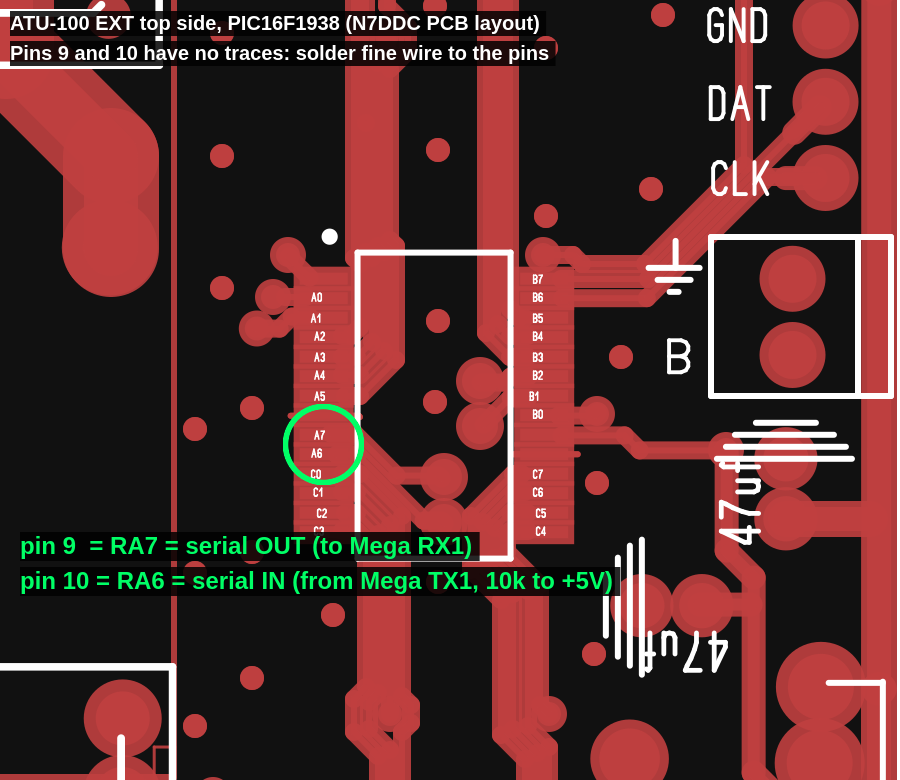

# Serial, display and buttons together

This branch (`display-buttons-uart`) keeps the ATU-100 EXT's display and all
three buttons working and adds the serial link from ukoda's remote firmware.
The serial port moves from the Auto/Bypass button pins to the two Tx_req pins,
which the original firmware used only to ask the transmitter for a carrier.

## Wiring

| PIC16F1938 pin | Schematic name | Signal | To an Arduino Mega |
|---|---|---|---|
| 9, RA7  | `RA7 - Tx_req`  | serial out of the tuner | RX1, pin 19 |
| 10, RA6 | `RA6 - /Tx_req` | serial into the tuner   | TX1, pin 18 |
| 8 or 19 | GND             | ground                  | GND |

On N7DDC's own EXT PCB (checked against his gerber files) pins 9 and 10 are
not routed anywhere: the "Tx_req" labels in the schematic are net names only.
Solder fine wire (wire-wrap or enamelled) straight to the two pins, then
anchor the wires with a dab of glue. Clone boards may differ.

- **Fit a 10 kΩ pull-up from RA6 to +5 V.** Port A has no internal pull-ups.
  Without one, an unconnected or unpowered serial partner leaves the input
  floating inside an RF box, and noise can look like commands.
- Optional but worth it inside an amplifier: 1 kΩ in series with each line at
  the PIC end, 100 pF to ground at the PIC side of the resistor, twisted pair
  with ground, ferrite on the cable.
- Both ends of a Mega are 5 V, so no level shifting. For a 3.3 V board (ESP32):
  divide the tuner's output with 2.2 kΩ / 3.3 kΩ, and pull RA6 up to 3.3 V
  instead of 5 V; 3.3 V is a valid high for the PIC.
- Serial: **4800 baud, 8N1**, lines end with `\n`.

The tuner no longer has a Tx_req output. Its `Tune` and `Tuned` events mark the
same interval: transmit a carrier from the first until the second.

## Programming

The 5-pin PROG header is also the display connector:

| PROG pin | 1 | 2 | 3 | 4 | 5 |
|---|---|---|---|---|---|
| signal | MCLR | +5 V | GND | DAT (RB7, PGD) | CLK (RB6, PGC) |

The pin order matches a PICkit's pins 1-5. Unplug the display while
programming.

1. **Save the tuner's settings first.** The eeprom holds the display type,
   relay values and calibration, and the hex file carries default eeprom
   contents. Read the whole chip with the programmer and keep the file; then
   either program with "preserve EEPROM" ticked (MPLAB IPE: Settings,
   Preserve EEPROM Memory), or restore over serial afterwards with
   `python/atu100hextojson.py` and `python/atu100.py -c u -e saved.json`.
2. The stock firmware ships with low-voltage programming off, so the first
   flash needs a programmer that supplies about 9 V on MCLR (any PICkit does).
   This firmware turns low-voltage programming on, so later updates work from
   plain 5 V programmers too.
3. A PICkit 3 needs MPLAB X / MPLAB IPE **v6.20 or older** (Microchip's
   archive page); v6.25 dropped the PICkit 3.
4. Build with `ATU_100_EXT_board/FirmWare_PIC16F1938/build.sh` (XC8 and the
   PIC12-16F1xxx device pack; paths at the top of the script) and program
   `build/cli/atu100.hex`.

## Talking to it

The protocol is ukoda's (see README.md), with these differences:

- Replies are one line each:
  `{"Auto":false,"Bypass":false,"Power":10.0,"Antenna":7.2,"Efficiency":72,"SWR":1.21,"Order":"CL","Capacitance":320,"Inductance":0}`
- `Power` is always the transmitter's power (as after PWR= on the display).
  `Antenna` (after feeder and mismatch loss) and `Efficiency` (%) are added
  while the display shows ANT/EFF, i.e. with cell 0x33 on and power present.
- `{"Raw": true}` returns the detector voltages in mV before the diode
  correction: `{"Fwd":2697,"Rev":1263}`.
- Events: `Startup`, `Restart` (after a watchdog reset), `Tune`, `Tuned`,
  `Reset`, `Overload`, `HighSWR`, `Error`.
- `HighSWR` goes out on the first reading with power on it (1 W, or 10 W in
  high power mode) at or above the limit in cell `0x37`, within a few ms. It
  is sent again only after the SWR has dropped 0.1 below the limit or the
  power has gone. The limit is BCD SWR x 10: `0x30` = 3.0 (also the default
  when the cell is `0xFF`), `0x00` = off. It is not checked during a tune.
- A status line goes out whenever something changes; `{"Status": true}` or
  `s` asks for one.
- Any new JSON message cancels a tune that is still waiting for carrier
  (relays reset, as with the Tune button), then gets handled.
- The buttons work as before, and serial commands act like button presses,
  including waking the display.
- Settings written with `{"Set": cell, "Value": n}` take effect at once,
  display settings included (the display restarts). N7DDC's manual lists the
  cells; this firmware adds two:
  - `0x36` tuning search: `0` is N7DDC's original, anything else (the
    default, `0xFF` on a stock eeprom) the log grid search.
    `{"Set": 54, "Value": 0}` switches to the original.
  - `0x37` HighSWR limit, see above. `{"Set": 55, "Value": 37}` (0x25) = 2.5.

## Arduino Mega starting point

`arduino/atu100_bridge/atu100_bridge.ino` passes the serial link through to the
Mega's USB port (so the python tools work through it), keeps the latest SWR,
power and relay values, and drives a pin high while the tuner is tuning.

## Testing without hardware

`ATU_100_EXT_board/FirmWare_PIC16F1938/test/run.sh` compiles the firmware for a
PC and runs it against a simulated Arduino on the serial line, the buttons,
an RF source and an antenna behind the relay network, then compares both
tuning searches over about a thousand antenna loads from 160 to 10 m.
