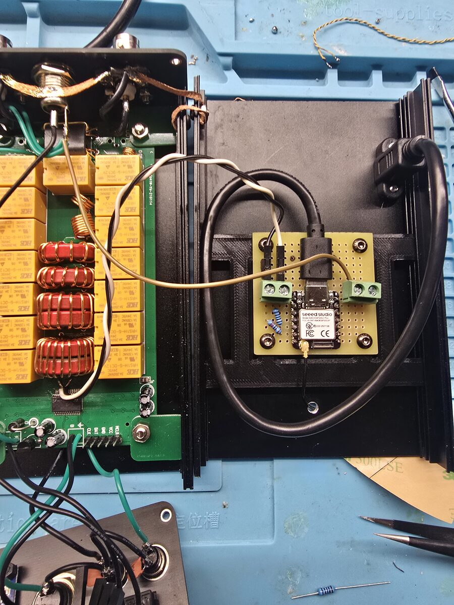
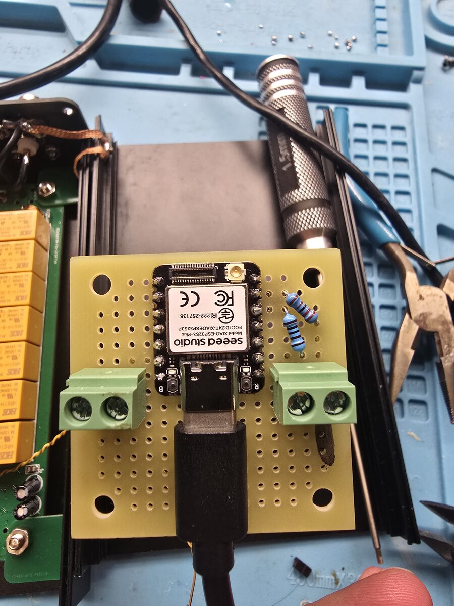
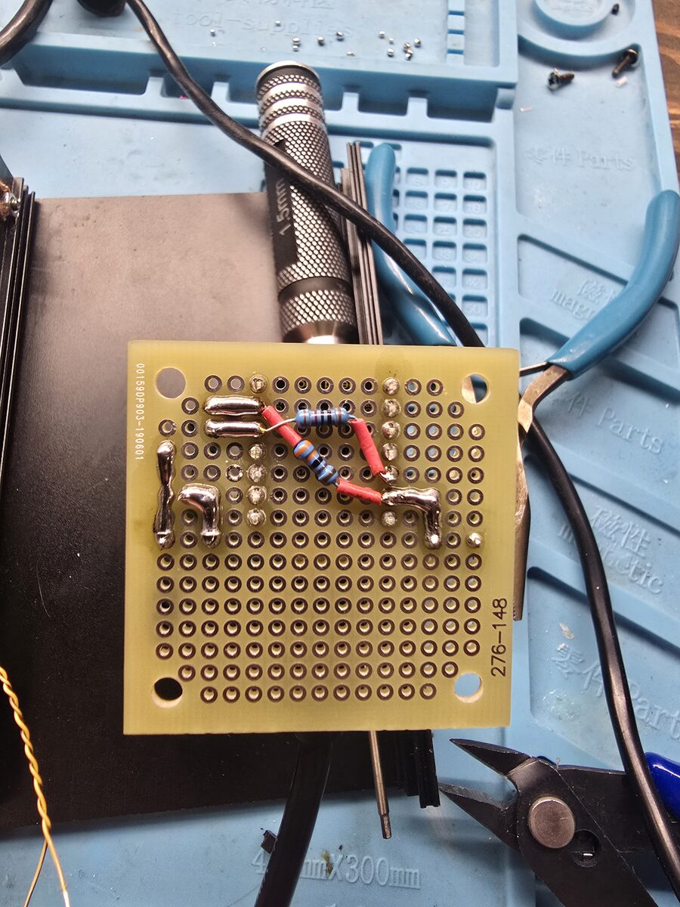
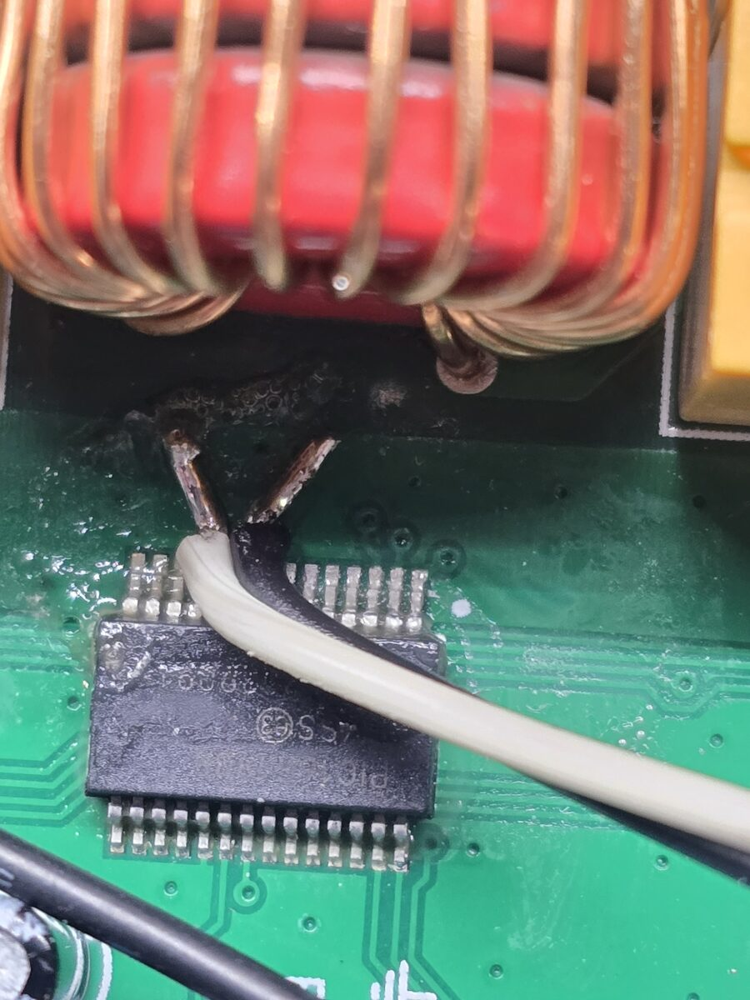
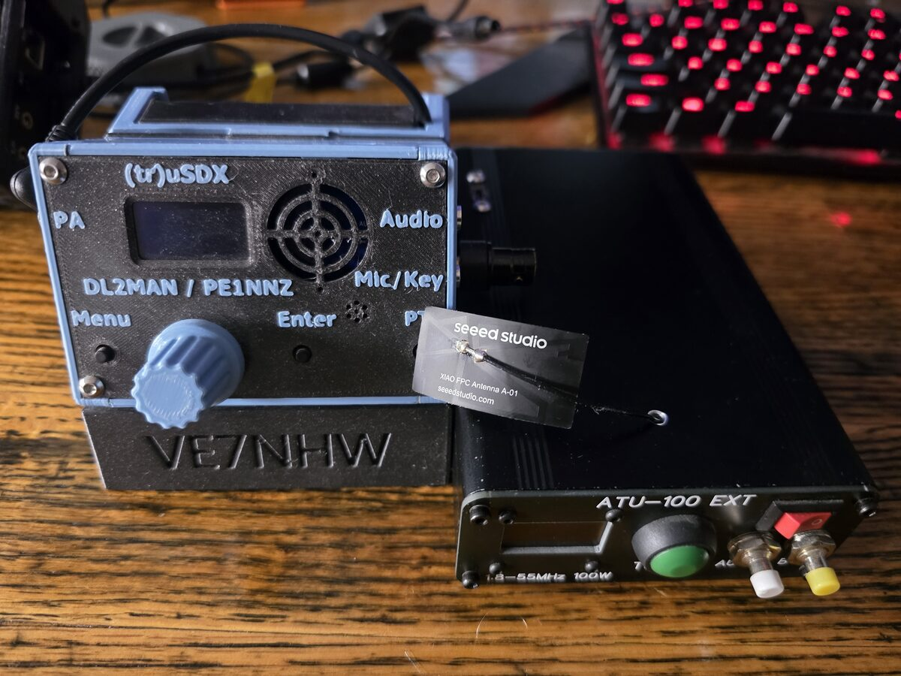

The first beta of the ATU-100 EXT firmware with the display, the buttons
and a serial link, plus the ESP32 bridge and atutop. It's been flashed on
my own tuner and tested on the air, and now it needs other tuners.

> [!IMPORTANT]
> Read the whole chip with your programmer and keep that hex **before** you
> flash: it is the only way back to your old firmware and settings. Then
> flash with **Preserve EEPROM** ticked.

## Two hex files: pick one

Both have the same display, buttons, serial link, alarms and settings.
They differ only in how they search for a match:

| File | Branch | Search |
|---|---|---|
| `ATU-100_model-search_1.1.1_beta1.hex` | `tune-research` | **The model search** (the one going forward): measures, calculates where the match is, and checks. In the simulator it gets 96% of antennas below SWR 1.5 in about 1.5 s. **On my tuner and tested on the air.** |
| `ATU-100_N7DDC-loggrid_1.0.1_beta1.hex` | `display-buttons-uart` | N7DDC's original search, or a log grid search (91% in about 3.7 s), picked in setting 36. Not yet on a real tuner. |

If you only flash one, flash the model search. If you can try both on the
same antennas, I'd love to hear how they compare.

## Highlights

### The display and all three buttons stay

Everything on the front panel works as in N7DDC's firmware. Earlier serial
versions took the display and buttons away; this one keeps them and puts
the serial port on PIC pins 9 and 10 (the Tx_req pins) instead.

### Serial control

4800 baud, JSON lines: SWR, transmitter and antenna power, efficiency,
relays, events, every setting. HighSWR and HighPower alarms, detector
readings, and settings that apply without a restart. Every setting a
PICkit would change can now be changed over the wire.

### atutop

A btop-style control program with gauges, graphs and mouse control. In a
terminal on Linux, or in any web browser (phone too), served by the ESP32
bridge. It shows every setting in plain units, including your own
measured inductor and capacitor values.

### ESP32 bridge

For a Seeed XIAO ESP32S3 Plus: USB and Wi-Fi to the tuner, atutop on its
web page, a plain page at `/lite`, TCP port 7000 for scripts, a port for an
Arduino Mega, and its own hotspot (**ATU100-setup**, password **hamradio**,
`http://192.168.73.1`) for use with no other network around.

### Bug fixes from the older firmware

The ADC sampling before its input settled, test mode limiting the
capacitors, a division by zero in the antenna power, stale power and
efficiency readings, serial bits corrupted when sending and receiving at
once, wrong L/C in bypass, and features the XC8 port had dropped (RF
waking the display, the 9999 W limit). The README has the full list.

## My build

| | |
|---|---|
|  |  |
| Tuner and bridge inside the tuner's case | The bridge board |
|  |  |
| Underside: the divider and pull-up | The two serial wires on PIC pins 9 and 10 |
|  | |
| Closed up, the Wi-Fi antenna on the outside of the case | |

## Downloads

| File | What |
|---|---|
| `ATU-100_model-search_1.1.1_beta1.hex` | Tuner firmware, model search (PIC16F1938, ATU-100 **EXT** only) |
| `ATU-100_N7DDC-loggrid_1.0.1_beta1.hex` | Tuner firmware, N7DDC + log grid searches |
| `atu100_bridge_XIAO_ESP32S3_Plus_beta1.bin` | ESP32 bridge, the whole flash image (write at address 0) |
| `atutop-linux-x86_64` | atutop for Linux (built on Arch; if it won't start, build it from `tui/` with `cargo build --release`) |

## Installing

1. **Programmer:** a PICkit 3 needs MPLAB IPE 6.20 or older, or the
   standalone PICkit 3 Programmer 3.1 on Windows (that's what worked for
   me; IPE 6.20 on Linux never connected). A PICkit 4 or 5 works with
   current MPLAB. Unplug the display: the PROG header is its connector.
2. **Back up**, then **flash** one hex with Preserve EEPROM ticked.
3. **Wire the serial link:** PIC pin 9 (RA7) is the tuner's output, pin 10
   (RA6) its input, 5 V logic. The README's Hardware and ESP32 sections
   have the full wiring, with the divider and pull-up for a 3.3 V board.
4. **ESP32 bridge:** `esptool.py --chip esp32s3 write_flash 0
   atu100_bridge_XIAO_ESP32S3_Plus_beta1.bin`, or Espressif's web flasher
   (espressif.github.io/esptool-js) at address 0x0. Power it from USB to
   start; for permanent use a 7805 from the tuner's 12 V (not the tuner's
   own 78L05, it only gives 100 mA).
5. **Check it:** run atutop (or open `http://192.168.73.1` on the hotspot),
   press `e` for the ATU-100 settings and check the display settings.

## Known issues

- **A thin junk line down one edge of a 0.96" OLED:** set setting 08
  (OLED columns left) to **00**. 02 is for the 1.3" (SH1106) displays.
- **Radios that fold back their power on high SWR** (the X6100 does): the
  power can drop below "Tunes from" (setting 05) while the search steps
  through bad settings, and the tune stops at a high SWR. Ideas, not tried
  yet: "Tunes from" at 1 W, a 3-6 dB attenuator between radio and tuner
  while tuning, or the radio's own SWR protection setting.
- **Tune with 5-10 W.** Below about 2 W the detector can't see small
  changes and every search stops short.
- **Not tried yet on real hardware:** the bridge on a home Wi-Fi network,
  the Arduino Mega port, a 7805 powering the bridge.
- **Inside a metal case** the XIAO's small Wi-Fi antenna is shielded: put
  it on the outside of the case (I stuck mine on top, lead through a small
  hole), or use a U.FL to SMA lead and an SMA antenna.
- The bridge's web page and port 7000 have no password. Change
  `HOTSPOT_PASS` in the firmware if others nearby might know the default.

## Reporting

Tell me how it goes, good or bad. With a problem, please say which hex,
which display, your radio, and what atutop's log showed. The full manual is the
[README](https://github.com/randal007/ATU-100-remote/blob/beta1/README.md).

Thanks to David N7DDC for the ATU-100, WA1RCT for the XC8 port, Edson
PP5OO, Željko Stevanović and David Annett (ukoda) for the serial work this
builds on.

73, Randal VE7NHW
